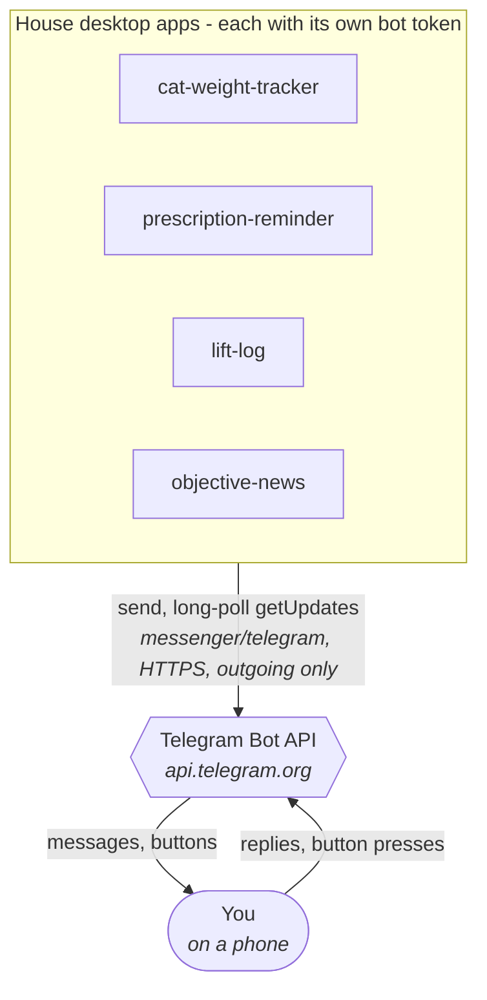
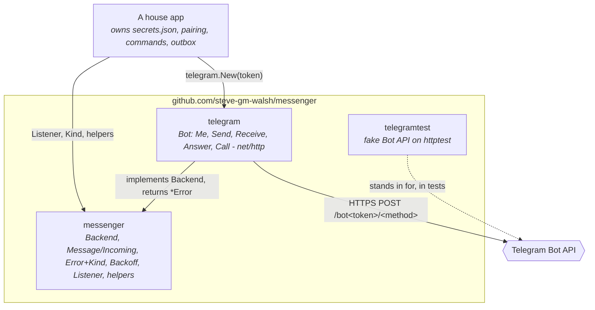

# messenger architecture

## Context

Each app has its own bot token. The apps never share a poller.

## Containers (packages)

## Where the lines are drawn

- **In the library:**
  - the wire format;
  - error classification;
  - backoff;
  - the poll loop;
  - token hygiene;
  - the fake.

  All four apps had copied these, with small differences.
- **In each app:**
  - `secrets.json` field names (two naming schemes are in use, and pairings must survive the migration);
  - how a chat is chosen (a pair code, the first chat to speak, or the last private chat);
  - where the poll cursor is stored (in memory, beside the secrets, or committed with the app's own state);
  - commands and wording;
  - prescription-reminder's durable outbox.

## Trust boundary

- **Traffic is outgoing only.** The library opens no socket that listens, so the apps' rule 8 posture is unchanged.
- **The bot token is a secret carried in the URL path.**
  - Transport errors, which quote the URL, are replaced by `Unreachable`.
  - A service description is scrubbed before it goes into `Error.Detail`.
  - `Error.Error()` is fixed text per `Kind`.
- **Incoming updates are untrusted.**
  - The library only parses them.
  - Deciding which chat to answer is the app's job: `Incoming.Private` and `From` are there for that check.
